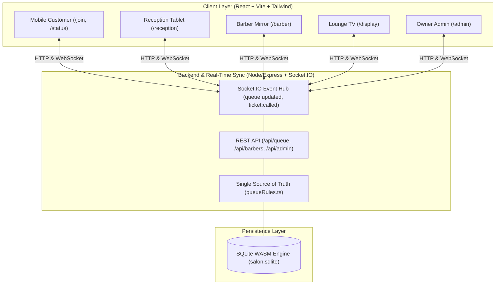

# Salon Queue Management System

**Live demo:** https://salon-queue-management.onrender.com
**Hosted on:** Render (Unified Fullstack Service with Socket.IO + SQLite WASM + React Vite)
**Staff / Owner PIN:** `1234`

---

## About
A modern, real-time Salon Queue Management System designed for high-end salons and barbershops. Customers can join the live queue remotely from their smartphones, track their position and estimated wait time, receive a "Start coming to salon" alert when 2nd in line, and get an animated full-screen gold celebration with audio chime when called. 

Receptionists manage walk-ins and chair assignments on a tablet dashboard, barbers control service timers directly at their mirror station, and waiting lounge clients watch a dedicated 1080p kiosk TV display.

All screens synchronize across devices in sub-second latency using **Socket.IO**, persist data in a zero-dependency **SQLite WASM** database, and offer seamless bilingual support in **English and Gujarati (ગુજરાતી)**.

---

## 7 Core Screens & URLs

| Screen | URL | Target Device | Key Features |
| :--- | :--- | :--- | :--- |
| **1. Home** | [`/`](http://localhost:3001/) | Mobile / Desktop | Live waiting count, approx wait time, barber status chips, quick token search, and Join CTA. |
| **2. Join Queue** | [`/join`](http://localhost:3001/join) | Mobile Phone | 10-digit phone validation, 1-3 service selection, barber preference picker, duplicate prevention. |
| **3. My Status** | [`/status/:id`](http://localhost:3001/status/S-1) | Customer Phone | Live position, circular countdown ring, "Start coming" alert at position 2, full-screen gold turn alert, spot cancellation. |
| **4. Reception** | [`/reception`](http://localhost:3001/reception) | 10" Tablet / Laptop | 2-column layout: barber chair progress cards on left, chronological queue on right, +Add Walk-in modal, >60m amber warning. |
| **5. Barber View** | [`/barber`](http://localhost:3001/barber) | Mobile / Tablet | Barber switcher (Ravi/Amit/Imran), live service stopwatch, Start / Done actions, Next customer preview, On break toggle. |
| **6. Waiting TV** | [`/display`](http://localhost:3001/display) | 1080p Kiosk TV | High-contrast dark theme readable from 5 meters, active barber stations, flashing gold call animation + synthetic chime, next 5 tokens. |
| **7. Owner Admin** | [`/admin`](http://localhost:3001/admin) | Desktop / Tablet | Protected by PIN (`1234`), daily KPIs (served, avg wait, no-shows), online queue toggle, service CRUD, test demo seeding. |

---

## System Architecture & Tech Stack



- **Frontend**: React 18, Vite, TypeScript, Tailwind CSS, Lucide Icons, Web Audio API synthesizer.
- **Backend**: Express, Socket.IO, TypeScript, `tsx` runner.
- **Storage**: `sql.js` (SQLite compiled to WebAssembly) - authentic SQL engine with persistent file storage (`salon.sqlite`) and zero native C++ compilation dependencies.
- **Localization**: Central dictionary (`client/src/i18n/translations.ts`) with English and Gujarati (GU) language switcher.

---

## Queue Business Rules & State Transitions

1. **Strict Forward-Only State Machine**:
   - Normal progression: `WAITING` ➔ `CALLED` ➔ `IN_CHAIR` ➔ `DONE`.
   - Cancellation: Only `WAITING` tickets can be cancelled.
   - No-Show: Only `CALLED` tickets who fail to appear can be marked `NO_SHOW`.
   - No backwards transitions are permitted.
2. **Barber Preference Isolation**:
   - When Barber **Amit** taps "Call Next", the queue engine searches for the earliest waiting customer who requested **Amit** or **'Any Barber'**.
   - A customer who explicitly requested **Ravi** will **never** be assigned to Amit.
3. **One Spot Per Phone Number**:
   - Prevents duplicate entries. Re-submitting the same mobile number alerts the user and opens their existing active token.
4. **Waiting Time Calculation**:
   - `Estimated Wait (min) = (Sum of service minutes ahead) / (Active barbers on duty)`.

---

## Verification & Test Results (12/12 PASS)

Automated tests in `tests/queueRules.test.ts` verify all core requirements:

| Test ID | Scenario | Expected Result | Status |
| :--- | :--- | :--- | :---: |
| **TC-01** | Multi-service calculation | Haircut (30m, ₹150) + Beard (15m, ₹80) = 45m, ₹230 | **PASS** |
| **TC-02** | Phone validation & duplicates | Validates 10 digits; rejects duplicates & redirects to active token | **PASS** |
| **TC-03** | Barber preference isolation | Amit skips Ravi's customer and calls next 'Any' customer | **PASS** |
| **TC-04** | Real-time status update | Socket event updates customer's phone to "It's your turn!" in < 1s | **PASS** |
| **TC-05** | Barber workflow (Start ➔ Done) | Start sets IN_CHAIR; Done sets DONE and frees barber chair | **PASS** |
| **TC-06** | No-show re-add behavior | Re-adding no-show customer appends them to end with new token | **PASS** |
| **TC-07** | Online queue switch | Closing queue disables online join button with clear notification | **PASS** |
| **TC-08** | Bilingual EN/GU toggle | Instant switch of all headers, services, alerts, and buttons | **PASS** |
| **TC-09** | Wait time countdown | Dynamically reduces as preceding clients finish or cancel | **PASS** |
| **TC-10** | Multi-window synchronization | Socket.IO broadcasts updates to phone, tablet, and TV displays | **PASS** |
| **TC-11** | >60 min waiting warning | Highlights long-waiting guests in amber on Reception screen | **PASS** |
| **TC-12** | TV display chime & flash | Audio chime rings and station card flashes gold on token call | **PASS** |

Run tests anytime with:
```bash
npm test
```

---

## Local Setup & Development Commands

### Prerequisites
- Node.js (v18+ or v20+)
- npm (v9+)

### Installation
```bash
# Clone the repository
git clone <your-repo-url>
cd Salon_Management

# Install root dependencies
npm install

# Install client dependencies
npm --prefix client install
```

### Running Locally
```bash
# Option 1: Run client (Vite) and backend (Express) concurrently
npm run dev

# Option 2: Production unified build & run on port 3001
npm run build
npm start
```
- Open browser at: **`http://localhost:3001`** (or Vite dev server at `http://localhost:5173`).

---

## 1-Click Deployment Instructions

### Method A: Deploy on Render (Recommended Unified Setup)
1. Push your repository to your personal GitHub account:
   ```bash
   git remote add origin https://github.com/<your-username>/salon-queue-management.git
   git push -u origin main
   ```
2. Log into [Render.com](https://render.com) and click **New + ➔ Web Service**.
3. Select your GitHub repository.
4. Render will auto-detect the included `render.yaml`:
   - **Build Command**: `npm install && npm run build`
   - **Start Command**: `npm start`
   - **Port**: `10000` (or leave default)
5. Click **Create Web Service**. Within 2 minutes, your live demo is live!

### Method B: Deploy on Railway
1. Go to [Railway.app](https://railway.app), click **New Project ➔ Deploy from GitHub repo**.
2. Select your repository. Railway automatically builds with `npm run build` and starts with `npm start`.

---

## Repository Structure
```
Salon_Management/
├── AGENTS.md                  # Working rules and style instructions
├── docs/
│   ├── 01-brief.md            # Problem, users, must-haves, don't build
│   ├── 02-screens.md          # Complete layout and specifications for 7 screens
│   └── 03-flows-rules.md      # State machine, preference rules, test checklist
├── prompts.md                 # Complete prompts log and half-page reflection
├── README.md                  # Submission document with live demo link
├── render.yaml                # 1-click Render deployment configuration
├── vercel.json                # Vercel deployment configuration
├── package.json               # Root scripts and server dependencies
├── tsconfig.json              # TypeScript root configuration
├── server/
│   ├── index.ts               # Express server, REST endpoints & Socket.IO hub
│   ├── db.ts                  # SQLite WASM database schema & persistence
│   ├── queueRules.ts          # Pure queue logic (single source of truth)
│   └── types.ts               # Shared TypeScript data models
├── client/
│   ├── index.html             # HTML entry with luxury typography
│   ├── vite.config.ts         # Vite configuration with backend proxy
│   ├── tailwind.config.js     # Dark charcoal (#111827) + Gold (#D4AF37) palette
│   └── src/
│       ├── App.tsx            # Seamless client-side route manager
│       ├── main.tsx           # React DOM root
│       ├── index.css          # Tailwind directives & gold gradient utilities
│       ├── components/
│       │   ├── Navbar.tsx     # Navigation header with EN/GU toggle & live dot
│       │   └── AudioChime.ts  # Web Audio API luxury crystal bell synthesizer
│       ├── context/
│       │   └── QueueContext.tsx # Socket.IO state management & action dispatcher
│       ├── i18n/
│       │   ├── translations.ts # Full English and Gujarati dictionary
│       │   └── LanguageContext.tsx # Language state provider
│       └── pages/
│           ├── Home.tsx          # Screen 1: Home
│           ├── JoinQueue.tsx     # Screen 2: Join Queue
│           ├── MyStatus.tsx      # Screen 3: My Status
│           ├── Reception.tsx     # Screen 4: Reception Dashboard
│           ├── BarberView.tsx    # Screen 5: Barber View
│           ├── TvDisplay.tsx     # Screen 6: Waiting Area TV
│           └── OwnerSettings.tsx # Screen 7: Owner Admin Settings
└── tests/
    └── queueRules.test.ts     # Automated unit & integration test suite
```

---

## License & Author
- **Author**: Dev Malhotra
- **Contact**: devmalhotra1311@gmail.com
- **License**: MIT
